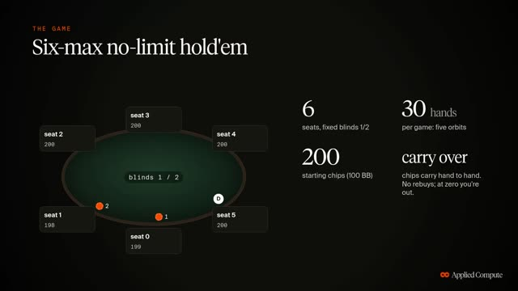
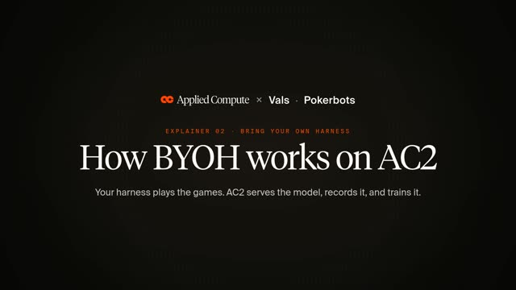
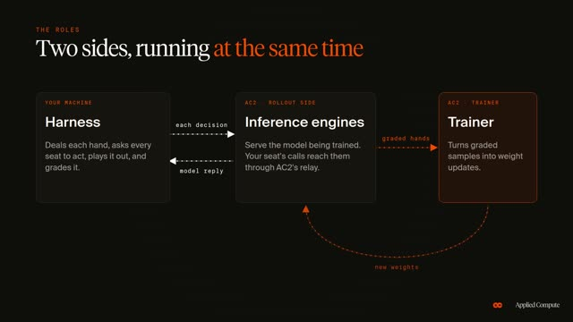
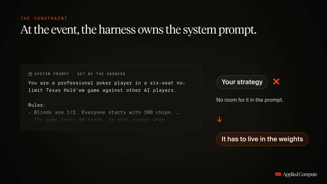
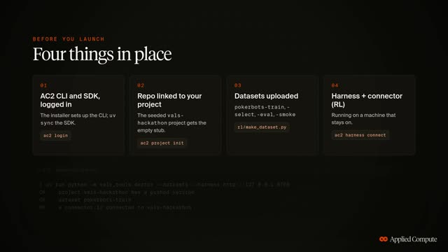
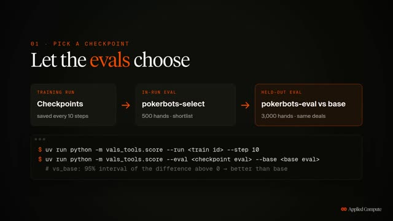
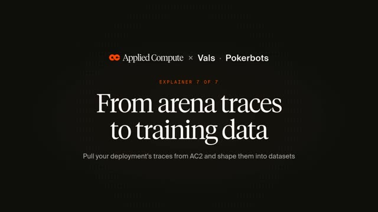

# Explainer videos

Seven short explainers, about 13 minutes in all. Watch them in order before following the
[main README](../README.md). Click a thumbnail or title to open the video; if it doesn't play inline on GitHub,
use **View raw** or download it.

| # | Thumbnail | Video | Length | What it covers |
| --- | --- | --- | --- | --- |
| 1 |  | [How the poker harness works](01-poker-harness.mp4) | 2:00 | How a game is dealt and played, what each seat sees, the scratchpad and cleanup turn, and how a hand is graded. |
| 2 |  | [How BYOH works on AC2](02-byoh-on-ac2.mp4) | 1:58 | Your harness plays the games, the connector links it to AC2, and AC2 serves, records and trains the model. |
| 3 |  | [How async RL works](03-async-rl.mp4) | 1:47 | How a GRPO run turns games through your harness into rewards and weight updates. |
| 4 |  | [How OPSD works](04-opsd.mp4) | 1:58 | Distilling a prompted hint into the weights with offline OPSD, from base traces to a hinted dataset. |
| 5 |  | [Launch and monitor a training run](05-launch-and-monitor.mp4) | 1:55 | What to have in place, launching `rl/train.py`, and watching the run, its in-run evals and checkpoints. |
| 6 |  | [Deploy a checkpoint and submit to the leaderboard](06-deploy-and-submit.mp4) | 1:51 | Deploying a checkpoint on 1 GPU, checking it calls the tool, and entering it in the arena. |
| 7 |  | [Turn your deployment's traces into datasets](07-traces-to-datasets.mp4) | 1:55 | Traces come from your deployment's gateway spans, read with `client.analytics.query` or the console's Requests tab. Request bodies need zero data retention (ZDR) off, which team orgs have by default; if they come back empty, ask the organizers. |
